# ESPHome Dotmatrix Clock


A clock for a 32 × 8 dot-matrix display built from four MAX7219 modules, driven by an ESP8266 (esp12e). The whole configuration is in [`dotmatrix-clock.yaml`](dotmatrix-clock.yaml).

- **Wiring:** SPI CLK = GPIO14, MOSI = GPIO5, CS = GPIO0.
- **Time:** SNTP (`pool.ntp.org`, Europe/Bratislava), re-synced every 15 minutes. The panel redraws every 50 ms, so the seconds change within tens of milliseconds of the real second.
- **Fonts:** `tom-thumb.bdf` (3×5, MIT) is included, ESPHome downloads Micro 5 from Google Fonts, and `MobileFont.ttf` has to be downloaded separately (see Installation).
- **Home Assistant:** connects over the native API; styles, the timer, dice and breathing exercise are exposed as entities.

Pick a style with the **Clock Style** entity in Home Assistant or in the device's web interface (port 80). The last choice survives a power loss.

## Styles

| # | Style | Preview |
|---|---|---|
| 0 | **Tom Thumb HH:MM:SS** – 3×5 digits, all the same width |  |
| 1 | **Micro 5 HH:MM:SS** – narrower colons |  |
| 2 | **Seconds Bar Top** – fills up until :30, then empties from the left |  |
| 3 | **Seconds Bar Bottom** |  |
| 4 | **Original** – a dash in the top row moves every two seconds |  |
| 5 | **Binary Clock** – 8-4-2-1 columns for HH MM SS | 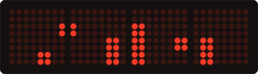 |
| 6 | **Rolling Digits** – a changing digit rolls up like a mechanical counter |  |
| 7 | **Time and Outdoor Temperature** – 7 s time, 3 s temperature from `weather.domov` | 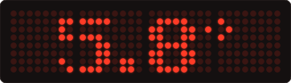 |
| 8 | **Time and Weekday** – Monday to Sunday markers, today fully lit | 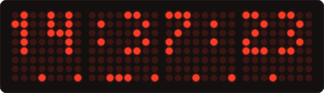 |
| 9 | **Hourglass Seconds** – one grain of sand drops onto a pile every second | 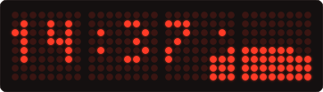 |
| 10 | **Time Falls Apart** – from :50 the digits turn into Conway's Game of Life | 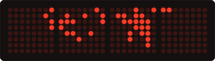 |
| 11 | **Pac-Man Eats the Minute** – on every new minute Pac-Man eats the old HH:MM |  |
| 12 | **Live Weather** – animated icon based on `weather.domov` |  |
| 13 | **Analog Watch** – 8×8 dial with hands and a seconds dot running around the edge | 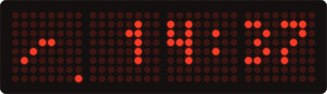 |
| 14 | **Time Emerges from the Rain** – digit pixels stick as drops pass through them | 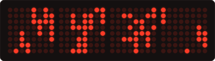 |
| 15 | **The Day in 256 Dots** – each dot is 5.6 minutes of the day | 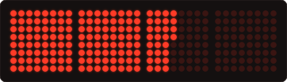 |
| 16 | **Moon Phase** – computed on the device, with a lunar-cycle bar |  |
| 17 | **Temperature, Last 24 Hours** – bar chart, one sample every 45 minutes | 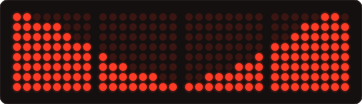 |
| 18 | **Snake Around the Clock** – a snake runs along the border and grows every second | 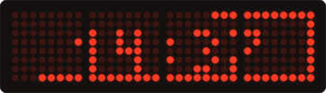 |
| 19 | **Pong Plays for Time** – left score is hours, right score is minutes | 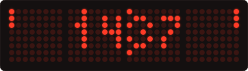 |
| 20 | **Warp to the Next Minute** – stars speed up until the jump | 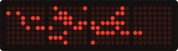 |
| 21 | **Month in Columns** – one column per day, weekends marked on top | 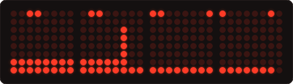 |
| 22 | **Matrix** – digital rain that forms the time and then scatters again |  |

The temperature chart (17) lives only in the device's memory: it starts over after a restart and shows a full day after 24 hours.

## Matrix in a 15-second cycle

| Phase | Preview |
|---|---|
| 0–5 s: rain falls | 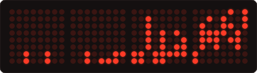 |
| 5–8 s: drops land in the shape of the digits and stick |  |
| 8–12 s: the time is shown |  |
| 12–15 s: the digits fall off and turn back into rain |  |

## Home Assistant extras

While active, these replace whichever style is selected.

| Entity | What it does | Preview |
|---|---|---|
| **Timer Minutes**, **Start Timer**, **Cancel Timer** | MM:SS countdown with a shrinking bar, blinks for 5 s at the end |  |
| **Breathing 4-7-8** | 4 s inhale, 7 s hold, 8 s exhale, four rounds | 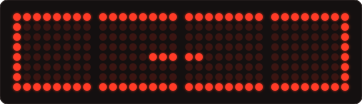 |
| **Roll Dice** | two dice tumble, then show the result for 8 s | 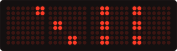 |
| **Restart** | restarts the device | |

## Installation

1. Copy `secrets.example.yaml` to `secrets.yaml` and fill in your Wi-Fi name and password.
2. Download **Mobile Font** from [anke-art.de](https://www.anke-art.de) (donation-ware, so it is not included) and save it as `MobileFont.ttf` next to the configuration.
3. Temperature and weather (styles 7, 12 and 17) read the `weather.domov` entity from Home Assistant. If yours is named differently, change `entity_id` in the `sensor` and `text_sensor` blocks.
4. Flash the firmware:

```sh
esphome run dotmatrix-clock.yaml
```

Later updates go over Wi-Fi (`--device dotmatrix-clock.local`).

The images in `docs/dotmatrix-clock/` are rendered from the same font bitmaps as the display, at 14:37.

## Licenses

- Tom Thumb (`tom-thumb.bdf`) by Robey Pointer: MIT.
- Micro 5: SIL Open Font License, downloaded from Google Fonts.
- Mobile Font: anke-art.de, donation-ware, not part of this repository.
